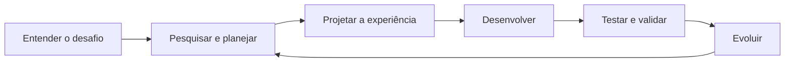

# LUMEN

### Tecnologia que transforma ideias em possibilidades.

**Desenvolvimento de soluções digitais com inovação, propósito e foco nas pessoas.**

[**Site oficial ↗**](https://lumen-ad-astra.vercel.app/) · [**Projetos**](#projetos-em-destaque) · [**Tecnologias**](#tecnologias) · [**Nossa equipe**](#equipe) · [**Contato**](#contato)

---

## Quem somos

A **Lumen** é uma equipe de tecnologia e inovação que transforma desafios em soluções digitais. Unimos engenharia de software, design e pensamento estratégico para desenvolver aplicações que simplificam processos, conectam informações e melhoram experiências.

Nossa ambição é explorar novas possibilidades por meio da tecnologia, sem perder de vista o impacto prático de cada produto.

> **Da primeira ideia à experiência final: tecnologia com direção, colaboração e propósito.**

## O que nos move

| Pilar | Nossa abordagem |
| :--- | :--- |
| **Inovação aplicada** | Investigamos problemas reais e construímos soluções com potencial de uso e evolução. |
| **Engenharia de qualidade** | Valorizamos arquitetura organizada, legibilidade, manutenção e boas práticas de desenvolvimento. |
| **Experiência do usuário** | Buscamos interfaces acessíveis, intuitivas e consistentes em diferentes plataformas. |
| **Segurança e responsabilidade** | Consideramos proteção de dados, confiabilidade das informações e cuidados com integrações. |
| **Colaboração e agilidade** | Trabalhamos de forma iterativa, compartilhando conhecimento e aprimorando continuamente nossas entregas. |

## Projetos em destaque

### BCI — Beyond Compare Intelligence

**Inteligência competitiva para o setor automotivo.**

Plataforma web de pesquisa, comparação e análise de veículos desenvolvida no contexto do desafio Ford. Centraliza informações sobre modelos e concorrentes, com recursos de inteligência artificial, insights, notas e acompanhamento de informações relevantes.

[**Repositório web →**](https://github.com/LUMEN-7/BCI) · [**Aplicação →**](https://beyond-compare.vercel.app/) · [**Versão mobile →**](https://github.com/LUMEN-7/BCI-Native)

### NEXUS

**Tecnologia para uma relação mais simples com o dinheiro.**

Aplicação mobile de organização financeira com foco na experiência de jovens usuários. Reúne fluxos de cadastro, conexão bancária, planejamento e simulações financeiras em uma experiência pensada para dispositivos móveis.

[**Conhecer o projeto →**](https://github.com/LUMEN-7/NEXUS)

### Outros trabalhos

Além dos projetos em destaque, desenvolvemos experiências, APIs e protótipos para diferentes desafios e contextos de aprendizado.

[**Explorar todos os repositórios →**](https://github.com/orgs/LUMEN-7/repositories)

## Tecnologias

Trabalhamos com diferentes linguagens, frameworks e serviços de acordo com as necessidades de cada solução.

## Nosso processo

Da descoberta do problema à validação do resultado, nossa abordagem integra **produto, design, desenvolvimento e melhoria contínua**.

## Equipe

A Lumen é construída por pessoas com diferentes perspectivas, que compartilham o compromisso de aprender, criar e entregar soluções de qualidade.

<table>
<tr>
<td align="center" width="20%"><a href="https://github.com/AnaTorresLoureiro"> <strong>Ana Laura Torres Loureiro</strong></a> RM 554375</td>
<td align="center" width="20%"><a href="https://github.com/MuriloCngp"> <strong>Murilo Cordeiro Ferreira</strong></a> RM 556727</td>
<td align="center" width="20%"><a href="https://github.com/Geronimo-augusto"> <strong>Geronimo Augusto Nascimento Santos</strong></a> RM 557170</td>
<td align="center" width="20%"><a href="https://github.com/Vitorr-AF"> <strong>Vitor Augusto França de Oliveira</strong></a> RM 555469</td>
<td align="center" width="20%"><a href="https://github.com/iannyrfs"> <strong>Ianny Raquel Ferreira de Souza</strong></a> RM 559096</td>
</tr>
</table>

## Contato

Quer conhecer nossos projetos, conversar sobre tecnologia ou colaborar com a equipe?

**[Conheça nosso site e envie uma mensagem →](https://lumen-ad-astra.vercel.app/#contato)**

[**GitHub da organização →**](https://github.com/LUMEN-7)

---

**LUMEN**

*Ideias que iluminam o futuro.*

Desenvolvido pela equipe Lumen · 2026

